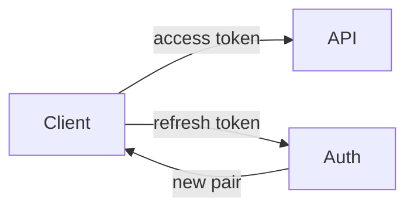

This document defines how sessions and refresh tokens behave after the v2 rewrite.
It replaces the notes in `docs/old-auth.md`, which is retained only for history.

## Overview

Every authenticated request carries a short-lived access token. Access tokens are
never renewed in place; a client exchanges a refresh token for a new pair.



## Tokens

Token lifetimes are global, not per-client. Changing them is a deploy-time
decision, not a runtime one.

<!-- agtrack:id grace-policy -->
### Rotation

Refresh tokens rotate on every use. The previous token stays valid for a grace
window of 60s to absorb in-flight requests.

<!-- agtrack:block lifetimes -->

| Token kind | Lifetime | Rotates |
|---|---|---|
| Access | 15 min | no |
| Refresh | 30 days | on every use |

Operators can inspect the current window without restarting the service:

```bash
# the grace window is read from the environment at boot
auth-cli config get TOKEN_GRACE_SECONDS
```

### Revocation

Revoking a refresh token revokes its entire family. A family is every token
descended from one successful login.

## Sessions

A session is the server-side record a token family points at.

### Revocation

Revoking a session revokes its token family, but not the reverse: a token family
may be revoked for reuse while the session stays live for audit.

### Idle timeout

Sessions idle for 14 days are closed by a nightly job.
