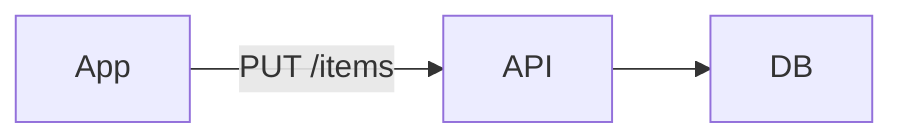

A minimal todo list: one user, items with a title and a done flag.

<!-- agtrack:id items -->
## Items

Each item has a title (1–512 chars) and a `done` flag that starts false.

<!-- agtrack:id creation -->
### Creation

Empty titles are rejected. Duplicate titles are allowed; creating one shows a
non-blocking warning ("an item with this title already exists") and the item is
still created.

### Deletion

Deleting an item is permanent; there is no trash.

## Lists

Items belong to exactly one list. A new user gets a list called "Inbox".

### Deletion

Deleting a list deletes its items.

| Action      | Confirms? |
|-------------|-----------|
| delete item | no        |
| delete list | yes       |

## Sync

Clients sync every 30s; last write wins.
