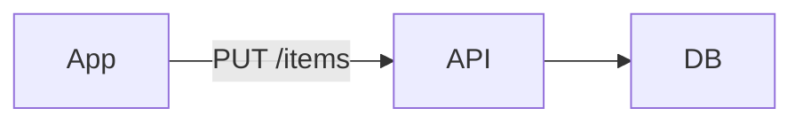

A minimal todo list: one user, items with a title and a done flag.

The product is a single-user personal list: no sharing, no assignees, no due dates.
A user organises items into lists and ticks them off as they finish them. Clients
(web and mobile) keep a local copy and sync it with the server in the background,
so the app stays usable offline.

This spec covers the item and list model, creation and deletion rules, and the sync
contract between clients and the API. Authentication, accounts and notifications are
out of scope and specified elsewhere.

<!-- agtrack:id items -->
## Items

Each item has a title (1–512 chars) and a `done` flag that starts false.

<!-- agtrack:id creation -->
### Creation

Empty titles are rejected. Duplicate titles are allowed; creating one shows a
non-blocking warning ("an item with this title already exists") and the item is
still created.

### Deletion

Deleting an item is permanent; there is no trash.

## Lists

Items belong to exactly one list. A new user gets a list called "Inbox".

### Deletion

Deleting a list deletes its items.

| Action      | Confirms? |
|-------------|-----------|
| delete item | no        |
| delete list | yes       |

## Sync

Clients sync every 30s; last write wins.
