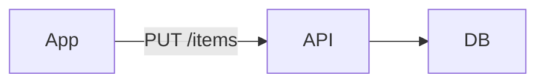
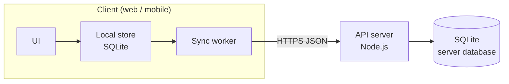

A minimal todo list: one user, items with a title and a done flag.

The product is a single-user personal list: no sharing, no assignees, no due dates.
A user organises items into lists and ticks them off as they finish them. Clients
(web and mobile) keep a local copy and sync it with the server in the background,
so the app stays usable offline.

This spec covers the item and list model, creation and deletion rules, and the sync
contract between clients and the API. Authentication, accounts and notifications are
out of scope and specified elsewhere.

<!-- agtrack:id items -->
## Items

Each item has a title (1–512 chars) and a `done` flag that starts false.

<!-- agtrack:id creation -->
### Creation

Empty titles are rejected. Duplicate titles are allowed; creating one shows a
non-blocking warning ("an item with this title already exists") and the item is
still created.

<!-- agtrack:id items-deletion -->
### Deletion

Deleting an item is permanent; there is no trash.

<!-- agtrack:id lists -->
## Lists

Items belong to exactly one list. A new user gets a list called "Inbox".

<!-- agtrack:id lists-deletion -->
### Deletion

Deleting a list deletes its items.

| Action      | Confirms? |
|-------------|-----------|
| delete item | no        |
| delete list | yes       |

<!-- agtrack:id sync -->
## Sync

Clients sync every 30s; last write wins.

<!-- agtrack:id architecture -->
## Architecture

Three parts, all written in TypeScript, with SQLite as the storage engine on both
sides of the sync.

<!-- agtrack:id stack -->
### Stack

| Layer | Choice |
|---|---|
| Language | TypeScript (strict mode) everywhere: clients, API, shared types |
| Web client | TypeScript SPA; local store is SQLite compiled to WebAssembly, persisted in the browser (OPFS) |
| Mobile client | TypeScript app with the platform's native SQLite |
| API server | Node.js (LTS) HTTP server in TypeScript |
| Server database | SQLite in WAL mode, one file per deployment |
| Shared code | One package of TypeScript types and validators (item, list, sync payloads) used by clients and API |

<!-- agtrack:id data-flow -->
### Data flow

Every change is written to the client's local SQLite store first, so the UI never waits
on the network. The sync worker sends changed rows to the API every 30s (and on app
start), and pulls rows changed on the server since its last sync. Each row carries an
`updated_at` timestamp; the newer write wins.

<!-- agtrack:id server-storage -->
### Server storage

The server keeps one SQLite database with `lists` and `items` tables mirroring the model
above. A single API process owns the file and serialises writes; there is no
multi-server deployment in scope.
